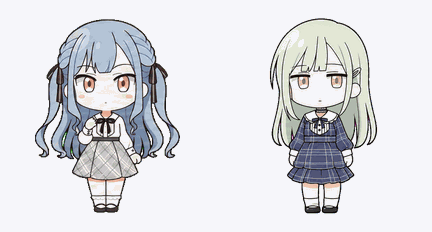

# 祥子与睦 · Codex 桌面宠物

以《元祖！バンドリちゃん》迷你动画造型为参考制作的丰川祥子、若叶睦自定义宠物。每位角色包含 9 种动画状态与 16 个视线方向，使用透明背景 WebP 精灵图。



## 下载

- [最新发布版本](https://github.com/ayin0914/codex-avemujica-pets/releases/latest)
- [双人合集 v1.0.0](https://github.com/ayin0914/codex-avemujica-pets/releases/download/v1.0.0/codex-avemujica-pets-v1.0.0.zip)
- [丰川祥子 v1.0.0](https://github.com/ayin0914/codex-avemujica-pets/releases/download/v1.0.0/sakiko-bandorichan-v1.0.0.zip)
- [若叶睦 v1.0.0](https://github.com/ayin0914/codex-avemujica-pets/releases/download/v1.0.0/mutsumi-bandorichan-v1.0.0.zip)
- [SHA-256 校验文件](https://github.com/ayin0914/codex-avemujica-pets/releases/download/v1.0.0/SHA256SUMS.txt)

## 手动安装

需要支持本地自定义宠物的 Codex 桌面版。下载压缩包并解压，保留角色文件夹名称；每个角色文件夹内必须直接包含 `pet.json` 和 `spritesheet.webp`。

**Windows**

1. 在文件资源管理器地址栏输入 `%USERPROFILE%\.codex\pets`，目录不存在时创建它。如果已自定义 `CODEX_HOME`，请改用 `%CODEX_HOME%\pets`。
2. 将解压得到的 `sakiko-bandorichan`、`mutsumi-bandorichan` 文件夹复制进去；单人包只需复制对应角色。已有同名文件夹时，先备份旧版。
3. 打开 Codex 的设置 → 宠物（Pets），刷新列表，选择“丰川祥子”或“若叶睦”。若未显示，重新打开设置或重启 Codex。

**macOS**

1. 在 Finder 中按 `⌘⇧G`，输入 `~/.codex/pets`，目录不存在时创建它。如果已自定义 `CODEX_HOME`，请打开该目录下的 `pets` 文件夹（即 `$CODEX_HOME/pets`）。
2. 将解压得到的角色文件夹复制进去；已有同名文件夹时，先备份旧版。
3. 打开 Codex 的设置 → 宠物（Pets），刷新列表并选择角色；若未显示，重新打开设置或重启 Codex。

安装完成后的目录结构如下；不要额外套一层压缩包名称或仓库的 `pets` 文件夹：

```text
pets/
├── sakiko-bandorichan/
│   ├── pet.json
│   └── spritesheet.webp
└── mutsumi-bandorichan/
    ├── pet.json
    └── spritesheet.webp
```

## 动作与显示

包含待机、向右移动、向左移动、挥手、跳跃、失落与恢复、等待回应、专注工作、检查结果，以及 16 方向视线跟随。预览 GIF 同时展示两位角色，实际选择方式以 Codex 的宠物设置为准。

精灵图为 RGBA `1536 × 2288`。当前已测试的 Codex 版本按固定的 `192 × 208` 单元格读取，并使用像素化缩放；部分缩放比例下边缘可能出现锯齿。在 Windows 屏幕缩放为 150% 的环境中，如当前版本提供宠物尺寸设置，可尝试将宠物宽度设为 `128` 来对齐显示像素；这只是该环境下的可选调整，请按自己的屏幕与版本选择尺寸。

## 来源与说明

本项目是 AI 辅助制作的非官方同人宠物，角色造型参考[官方《元祖！バンドリちゃん》Ave Mujica 角色页](https://anime.bang-dream.com/bandorichan/character/avemujica/)。动画帧为本项目制作，并非官方动画逐帧截取；本项目与官方及 OpenAI 无关联，也未获其背书。

角色、名称及原作相关权利归各自权利人所有。本仓库不对这些角色或原作素材授予开源许可。
